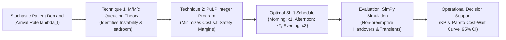

# SmartCare OR — Comprehensive Project Guide & Defense Handbook
## *Intelligent Hospital Patient Wait-Time Optimization System*

**Academic Project Title:** *Design and Development of Operations Research Techniques to Reduce Patient Waiting Times in Hospitals*  
**Domain:** Healthcare Operations Research (OR), Queueing Theory, Integer Linear Programming (ILP), Discrete-Event Simulation (DES)  
**Software Stack:** Python 3.11–3.14, Streamlit, PuLP (COIN-OR CBC Solver), SimPy, NumPy, SciPy, Pandas, Plotly, pytest  

---

## Table of Contents
1. [Executive Summary & The Healthcare Congestion Dilemma](#1-executive-summary--the-healthcare-congestion-dilemma)
2. [Operations Research Foundations & Mathematical Models](#2-operations-research-foundations--mathematical-models)
   - [2.1 Technique 1: M/M/c Queueing Theory Analyzer](#21-technique-1-mmc-queueing-theory-analyzer)
   - [2.2 Technique 2: Optimal Staff Scheduling via Integer Linear Programming](#22-technique-2-optimal-staff-scheduling-via-integer-linear-programming)
   - [2.3 Evaluation Engine: Discrete-Event Patient Flow Simulation (SimPy)](#23-evaluation-engine-discrete-event-patient-flow-simulation-simpy)
   - [2.4 Statistical Rigor: Paired Differences & Common Random Numbers (CRN)](#24-statistical-rigor-paired-differences--common-random-numbers-crn)
3. [Software Architecture & Codebase Map](#3-software-architecture--codebase-map)
4. [How to Use the Project: Step-by-Step Operator's Manual](#4-how-to-use-the-project-step-by-step-operators-manual)
   - [4.1 Installation & Automated Test Verification](#41-installation--automated-test-verification)
   - [4.2 Running the Interactive Streamlit Web Application](#42-running-the-interactive-streamlit-web-application)
   - [4.3 Detailed Feature Walkthrough by Page](#43-detailed-feature-walkthrough-by-page)
   - [4.4 Programmatic & Scripting Usage (Python API)](#44-programmatic--scripting-usage-python-api)
5. [How to Explain and Defend the Project: Presentation & Viva Guide](#5-how-to-explain-and-defend-the-project-presentation--viva-guide)
   - [5.1 The 30-Second Elevator Pitch](#51-the-30-second-elevator-pitch)
   - [5.2 3-to-5 Minute Live Demonstration Script](#52-3-to-5-minute-live-demonstration-script)
   - [5.3 Tailored Explanations for Different Audiences](#53-tailored-explanations-for-different-audiences)
   - [5.4 In-Depth Analysis of Experimental Benchmark Results](#54-in-depth-analysis-of-experimental-benchmark-results)
   - [5.5 Anticipated Evaluator / Viva Questions & Model Answers](#55-anticipated-evaluator--viva-questions--model-answers)
6. [Assumptions, Limitations & Future Extensions](#6-assumptions-limitations--future-extensions)
7. [Academic References](#7-academic-references)

---

## 1. Executive Summary & The Healthcare Congestion Dilemma

### 1.1 The Problem
Hospital emergency departments (EDs), outpatient clinics, and ambulatory surgery centers worldwide face severe operational congestion. Patients suffer prolonged waiting times in waiting rooms, clinical staff experience severe burnout, and hospital operational expenses escalate uncontrollably.

A fundamental operational root cause is the **temporal mismatch between time-varying stochastic patient arrivals and rigid, uniform doctor staffing schedules**:
- **Arrival Volatility:** Patient arrivals fluctuate dynamically across the day (e.g., quiet mornings, massive early-afternoon surges, steady evening flows).
- **The Non-Linear "Hockey Stick" Queueing Effect:** In stochastic queues, congestion does **not** increase linearly. As server utilization approaches capacity ($\rho = \frac{\lambda}{c\mu} \to 1.0$), queue length and patient wait time increase asymptotically towards infinity.
- **The Pitfall of Uniform Staffing:** Assigning a constant number of physicians across all shifts creates a fatal double failure:
  1. Understaffing during peak demand periods triggers exponential queue build-up and instability ($\rho > 1.0$).
  2. Overstaffing during off-peak periods wastes thousands of dollars in physician idle hours.
- **The Budget Constraint:** Hospitals cannot simply solve wait times by hiring unlimited doctors; physician hours are one of the single most expensive operational budget items.

```
       Patient Wait Time (Wq)
              ^
              |               / (Catastrophic Queue Explosion as rho -> 1)
              |              /
              |             /
              |            /
              |          _/
              |       __/
              |______/
              +-----------------------------> Server Utilization (rho = lambda / c*mu)
              0.0    0.5    0.7   0.85  1.0 (Capacity Limit)
```

### 1.2 The SmartCare OR Solution
SmartCare OR solves this challenge through a rigorous, closed-loop Operations Research methodology:
1. **Analytical Diagnosis ($M/M/c$ Queueing Theory):** Mathematically models steady-state congestion, calculates Erlang C waiting probabilities, and immediately detects shift instability boundaries ($\rho \ge 1.0$).
2. **Prescriptive Optimization (Integer Linear Programming via PuLP & COIN-OR CBC):** Formulates and solves an integer scheduling model that allocates the exact integer number of physicians required per shift to satisfy capacity safety margins ($\mu_t x_t \ge \lambda_t + \delta_t$) while minimizing total daily staffing payroll subject to workforce limits and budget ceilings.
3. **Empirical Validation (SimPy Discrete-Event Simulation):** Because real hospitals operate over finite shifts with continuous queues and non-preemptive physician handovers (doctors complete current consultations before clocking out), SimPy simulates individual patient arrivals and doctor consultations to validate theoretical wait reductions under real-world operational conditions.



---

## 2. Operations Research Foundations & Mathematical Models

### 2.1 Technique 1: M/M/c Queueing Theory Analyzer

The analytical foundation uses Kendall's notation $M/M/c$:
- **Arrivals ($M$):** Stationary Poisson process with mean rate $\lambda$ (patients/hour). Interarrival times $A \sim \text{Exponential}(\lambda)$ with $\mathbb{E}[A] = 1/\lambda$.
- **Service ($M$):** Consultation durations $S \sim \text{Exponential}(\mu)$ with mean consultation time $\mathbb{E}[S] = 1/\mu$ hours per doctor (service rate $\mu$ patients/hour/doctor).
- **Servers ($c$):** $c$ identical, parallel doctors drawing from a single central First-Come, First-Served (FCFS) waiting queue.
- **Queue Capacity:** Infinite waiting capacity ($M/M/c/\infty/\infty$).
- **Patient Behavior:** Patients do not balk (refuse to enter) or renege (abandon the queue).

#### Mathematical Formulations

1. **Traffic Intensity (Offered Load):**
   $$a = \frac{\lambda}{\mu} \quad \text{(Erlangs)}$$

2. **Server Utilization Factor ($\rho$):**
   $$\rho = \frac{\lambda}{c \mu}$$

3. **Steady-State Stability Criterion:**
   $$\rho < 1.0 \iff \lambda < c \mu$$
   > [!IMPORTANT]
   > When $\lambda \ge c\mu$, the arrival rate meets or exceeds the total service capacity. Under an infinite horizon, queue length and waiting time diverge to infinity ($L_q \to \infty$, $W_q \to \infty$). SmartCare OR explicitly flags this condition as **Unstable ($\rho \ge 1.0$)** and outputs required minimum doctor capacity.

4. **Probability of an Empty System ($P_0$):**
   Derived from the birth-death Markov balance equations:
   $$P_0 = \left[ \sum_{n=0}^{c-1} \frac{a^n}{n!} + \frac{a^c}{c!(1 - \rho)} \right]^{-1}$$

5. **Probability of Waiting (Erlang C Formula, $P_w$):**
   The probability that an arriving patient finds all $c$ doctors busy and must wait in the waiting room:
   $$P_w = P(N \ge c) = \frac{a^c}{c!(1 - \rho)} P_0$$

6. **Average Queue Length ($L_q$):**
   The expected number of patients waiting in the waiting room (excluding those currently being consulted):
   $$L_q = \frac{P_w \rho}{1 - \rho} = \frac{P_0 a^c \rho}{c!(1 - \rho)^2}$$

7. **Little's Law — Average Waiting Time in Queue ($W_q$):**
   $$W_q = \frac{L_q}{\lambda} \quad (\text{hours}) = \frac{L_q}{\lambda} \times 60 \quad (\text{minutes})$$

8. **Total System Time ($W$) and Total Patients in System ($L$):**
   $$W = W_q + \frac{1}{\mu} \quad (\text{hours}), \qquad L = \lambda W = L_q + a$$

9. **Special Case: $M/M/1$ ($c = 1$):**
   When $c = 1$, the formulas simplify to the classic single-server equations:
   $$P_0 = 1 - \rho, \quad P_w = \rho, \quad W_q = \frac{\lambda}{\mu(\mu - \lambda)}, \quad W = \frac{1}{\mu - \lambda}, \quad L_q = \frac{\lambda^2}{\mu(\mu - \lambda)}$$

---

### 2.2 Technique 2: Optimal Staff Scheduling via Integer Linear Programming

Real hospital operations are segmented into discrete shifts $T = \{1, 2, \dots, |T|\}$ (e.g., Morning 09:00–12:00, Afternoon 12:00–15:00, Evening 15:00–18:00).

#### Model Parameters
- $d_t$: Duration of shift $t$ in hours (e.g., $d_t = 3.0$).
- $\lambda_t$: Forecasted patient arrival rate during shift $t$ (patients/hour).
- $\mu_t$: Consultation service rate per physician during shift $t$ (patients/hour/doctor).
- $w_t$: Staffing wage/cost per doctor-hour during shift $t$ ($/doctor-hour).
- $\delta_t$: Capacity safety margin buffer required above nominal arrival rate (patients/hour).
- $c_{\min, t}, c_{\max, t}$: Operational lower and upper limits on doctor allocation per shift.
- $W_{\max}$: Peak simultaneous workforce limit (maximum doctors permitted in any shift).
- $B$: Hard financial budget ceiling for total daily doctor payroll ($).

#### Decision Variables
$$x_t \in \mathbb{Z}^+, \quad \forall t \in T$$
Where $x_t$ is the integer number of doctors scheduled to work during shift $t$.

#### Mathematical Formulation (Standard ILP)
$$\min_{x_t} \quad Z = \sum_{t \in T} d_t w_t x_t$$

**Subject to:**

1. **Capacity Safety Margin Constraint (Linear Integer Formulation):**
   $$\mu_t x_t \ge \lambda_t + \delta_t \quad \forall t \in T$$
   *Explanation:* This constraint guarantees that the total consultation capacity of the shift ($\mu_t x_t$) strictly exceeds expected demand ($\lambda_t$) by a safety buffer $\delta_t$, ensuring utilization remains safely below 1.0 ($\rho_t \le \frac{\lambda_t}{\lambda_t + \delta_t} < 1.0$). Mathematically, this forces:
   $$x_t \ge \left\lceil \frac{\lambda_t + \delta_t}{\mu_t} \right\rceil$$

2. **Shift Workforce Bounds:**
   $$c_{\min, t} \le x_t \le c_{\max, t} \quad \forall t \in T$$

3. **Peak Workforce Availability Limit:**
   $$x_t \le W_{\max} \quad \forall t \in T$$

4. **Total Daily Staffing Budget Ceiling:**
   $$\sum_{t \in T} d_t w_t x_t \le B$$

5. **Integrality Constraint:**
   $$x_t \in \{1, 2, 3, \dots\} \quad \forall t \in T$$

#### Variant: Wait-Time Bounded Optimization & Pareto Analysis
In addition to the standard cost-minimizing ILP, SmartCare OR implements a **Wait-Time Constrained Optimizer**:
$$\min_{x_t} \quad \sum_{t \in T} d_t w_t x_t \quad \text{subject to} \quad \bar{W}_q(x) \le W_{\text{target}}$$
where $\bar{W}_q(x) = \frac{\sum_{t \in T} \lambda_t d_t W_{q, t}(x_t)}{\sum_{t \in T} \lambda_t d_t}$.

Because $W_q(x_t)$ is non-linear in $x_t$, the system sweeps across the discrete integer decision space $\{x_t\}$ to construct the **Pareto Optimal Frontier** (Cost vs. Waiting Time), enabling hospital executives to evaluate the exact dollar cost of saving one additional minute of patient waiting time.

---

### 2.3 Evaluation Engine: Discrete-Event Patient Flow Simulation (SimPy)

While analytical queueing models provide foundational insights, they rely on steady-state assumptions that do not fully capture finite hospital operations. SmartCare OR embeds a full discrete-event simulation engine in **SimPy** to address real-world operational dynamics:

1. **Non-Homogeneous Poisson Process (NHPP):** Arrival rates $\lambda_t$ step dynamically across shift boundaries without resetting waiting queues.
2. **Non-Preemptive Shift Transitions:** When a shift ends and scheduled doctor capacity drops (e.g., from 4 doctors to 2), off-duty doctors do not abandon patients mid-consultation. In SimPy, active consultations are completed before the server resource is released.
3. **Queue Continuity Across Shifts:** Patients remaining in the waiting room at the end of Shift $t$ carry over into Shift $t+1$, accurately simulating morning backlogs that spill into afternoon bottlenecks.
4. **Finite-Horizon Transients:** Real outpatient clinics open in the morning with empty waiting rooms. SimPy captures the empty-to-full development and transient queue buildup that steady-state models miss.
5. **Continuous Time-Weighted Queue Length Accounting:**
   Rather than simple discrete snapshots, SimPy calculates the exact time-weighted average queue length:
   $$\bar{L}_{q, \text{sim}} = \frac{1}{T_{\text{horizon}}} \int_0^{T_{\text{horizon}}} Q(t) \, dt$$
6. **Doctor Utilization Accounting:**
   Calculated as the exact ratio of doctor consultation time to total scheduled doctor-hours:
   $$U_{\text{sim}} = \frac{\sum_{i \in \text{patients}} \text{Consultation Duration}_i}{\sum_{t \in T} d_t x_t}$$

---

### 2.4 Statistical Rigor: Paired Differences & Common Random Numbers (CRN)

To eliminate random noise when comparing the Baseline schedule against the ILP Optimized schedule, the simulation uses **Common Random Numbers (CRN)**:
- Both policies are evaluated against the exact same pseudorandom patient arrival streams and consultation service times ($RNG_{\text{arrival}}$ and $RNG_{\text{service}}$ seeded identically).
- For multi-replication runs ($K$ replications), the system computes the paired difference:
  $$D_k = W_{q, \text{baseline}, k} - W_{q, \text{optimized}, k}, \quad k = 1, \dots, K$$
- The sample mean difference $\bar{D}$ and sample standard deviation $s_D$ yield the paired Student's $t$ confidence interval:
  $$\bar{D} \pm t_{1 - \alpha/2, \, K-1} \cdot \frac{s_D}{\sqrt{K}}$$
  Where $t_{0.975, K-1}$ is the critical $t$-value for a 95% confidence interval.

---

## 3. Software Architecture & Codebase Map

SmartCare OR is structured following production software engineering and scientific computing best practices:

```
OR_Project/
|-- app.py                          # Streamlit Master Dashboard & 1-Click Live Demo
|
|-- pages/
|   |-- 1_Queueing_Theory.py        # Technique 1: Interactive M/M/c Analyzer & Sensitivity Curves
|   |-- 2_Staff_Optimization.py     # Technique 2: PuLP ILP Optimizer & Pareto Trade-Off Frontier
|   |-- 3_Patient_Simulation.py     # Evaluation: SimPy Patient Flow Engine, Logs & Histograms
|   |-- 4_Experiment_Comparison.py  # Multi-Scenario Benchmark Suite & Statistical Reporting
|   |-- 5_Methodology.py            # Academic Foundations, Formal Derivations & Citations
|
|-- src/
|   |-- __init__.py
|   |-- models/
|   |   |-- queueing.py             # Exact M/M/c math, Erlang C, Little's Law, numerical stability
|   |   |-- scheduling.py           # PuLP ILP model, CBC solver interface, Pareto frontier generator
|   |-- simulation/
|   |   |-- patient_flow.py         # SimPy discrete-event simulation, non-preemptive shift handovers
|   |   |-- scenarios.py            # Predefined benchmark configurations (Scenarios A, B, and C)
|   |-- experiments/
|   |   |-- runner.py               # Coordinated end-to-end experiment pipeline
|   |   |-- metrics.py              # Statistical metrics, paired t-tests, 95% CIs, percentage deltas
|   |-- data/
|   |   |-- schemas.py              # Typed dataclasses (TimeSlot, QueueingResult, OptimizationResult)
|   |   |-- generators.py           # Synthetic arrival stream generator & CSV import validator
|   |-- utils/
|       |-- theme.py                # Publication-grade Plotly interactive visualizations
|       |-- session.py              # Multi-page Streamlit session state manager
|       |-- export.py               # JSON and CSV data serialization utilities
|
|-- tests/
|   |-- test_queueing.py            # M/M/1 agreement, M/M/c known values, instability, edge cases
|   |-- test_scheduling.py          # Integrality, safety margins, budget limits, infeasibility
|   |-- test_simulation.py          # Reproducibility, conservation of patients, chronological order
|   |-- test_metrics.py             # Reduction %, non-clamping of negatives, zero baseline
|   |-- test_experiments.py         # Full pipeline execution and serialization verification
|
|-- data/
|   |-- README.md                   # Data schemas, scenario parameters, and CSV format guidelines
|
|-- reports/
|   |-- methodology.md              # Mathematical derivations, proofs, and theoretical equations
|   |-- experimental_results.md     # Genuine, computed benchmark results and analytical findings
|   |-- smartcare_complete_project_guide.md # Master project guide and presentation handbook
|
|-- requirements.txt                # Pinned dependency definitions
|-- pytest.ini                      # Pytest runner configuration
`-- README.md                       # High-level repository overview
```

### Module Responsibilities at a Glance

| Module | Core Purpose | Key Functions / Classes |
| :--- | :--- | :--- |
| `src.models.queueing` | Implements exact $M/M/c$ analytical formulas | `calculate_mmc()`, `calculate_mmc_sensitivity_servers()`, `calculate_mmc_sensitivity_arrivals()` |
| `src.models.scheduling` | Formulates and solves integer programs via PuLP | `optimize_staff_ilp()`, `optimize_staff_wait_time_constrained()`, `evaluate_schedule()`, `generate_cost_vs_waittime_pareto()` |
| `src.simulation.patient_flow` | Discrete-event patient flow simulation in SimPy | `HospitalSimulation`, `run_multi_replication_simulation()` |
| `src.experiments.runner` | Orchestrates baseline, ILP, and SimPy evaluations | `ExperimentRunner.run_full_experiment()`, `is_finite_number()` |
| `src.experiments.metrics` | Calculates statistics, paired differences, and CIs | `calculate_wait_reduction_pct()`, `calculate_cost_savings_pct()`, `compute_paired_comparison_stats()` |
| `src.data.schemas` | Type-safe dataclass definitions | `TimeSlot`, `QueueingResult`, `OptimizationResult`, `SimulationMetrics`, `PatientRecord` |
| `src.utils.theme` | Healthcare-themed interactive Plotly graphics | `plot_staffing_allocation_comparison()`, `plot_queueing_hockey_stick()`, `plot_simulation_wait_distribution()` |

---

## 4. How to Use the Project: Step-by-Step Operator's Manual

### 4.1 Installation & Automated Test Verification

#### Prerequisites
- Operating System: macOS, Linux, or Windows.
- Python 3.11+ (verified up to Python 3.14).

#### Step 1: Install Dependencies
Open your terminal in the `OR_Project` root directory:
```bash
pip install -r requirements.txt
```
*Dependencies installed:* `streamlit`, `numpy`, `scipy`, `pandas`, `pulp`, `simpy`, `plotly`, `pytest`.

#### Step 2: Run the Automated Test Suite
Before launching the application, verify mathematical and algorithmic integrity:
```bash
pytest -v tests/
```
**Expected Output:**
```
tests/test_experiments.py::test_full_experiment_pipeline_execution PASSED
tests/test_metrics.py::test_wait_reduction_standard_case PASSED
tests/test_metrics.py::test_wait_reduction_deterioration_not_clamped PASSED
tests/test_metrics.py::test_wait_reduction_zero_baseline PASSED
tests/test_metrics.py::test_wait_reduction_unstable_baseline PASSED
tests/test_metrics.py::test_cost_savings_calculation PASSED
tests/test_metrics.py::test_paired_comparison_stats PASSED
tests/test_queueing.py::test_mm1_special_case_exact_match PASSED
tests/test_queueing.py::test_mmc_known_analytical_values PASSED
tests/test_queueing.py::test_unstable_queue_handling PASSED
tests/test_queueing.py::test_zero_arrivals PASSED
tests/test_queueing.py::test_monotonicity_additional_doctors PASSED
tests/test_queueing.py::test_monotonicity_increasing_arrivals PASSED
tests/test_queueing.py::test_numerical_stability_large_c PASSED
tests/test_queueing.py::test_invalid_input_validation PASSED
tests/test_scheduling.py::test_ilp_optimal_solution_and_integer_values PASSED
tests/test_scheduling.py::test_ilp_respects_workforce_limit PASSED
tests/test_scheduling.py::test_ilp_respects_budget_constraint PASSED
tests/test_scheduling.py::test_wait_time_constrained_optimization PASSED
tests/test_scheduling.py::test_pareto_frontier_generation PASSED
tests/test_simulation.py::test_simulation_reproducibility_with_seed PASSED
tests/test_simulation.py::test_patient_conservation_law PASSED
tests/test_simulation.py::test_event_chronology_and_non_negative_times PASSED
tests/test_simulation.py::test_multi_replication_confidence_interval PASSED
============================== 24 passed in 2.64s ==============================
```
*All 24 unit tests pass, validating zero-arrival edge cases, Erlang C stability thresholds, CBC solver bounds, and SimPy patient conservation laws.*

---

### 4.2 Running the Interactive Streamlit Web Application

To launch the web interface, execute:
```bash
streamlit run app.py
```
The application will open in your default browser at `http://localhost:8501`.

---

### 4.3 Detailed Feature Walkthrough by Page

#### Main Page: Overview Dashboard (`app.py`)
1. **Sidebar System Configuration:**
   - **Select Hospital Demand Scenario:** Choose between:
     - `Scenario A: Low Demand` ($\lambda = [7, 9, 8]$)
     - `Scenario B: Moderate Demand (Standard)` ($\lambda = [14, 18, 15]$)
     - `Scenario C: Peak Demand (Emergency Congestion)` ($\lambda = [20, 26, 22]$)
   - **Simulation Controls:** Adjust replication count (1–10), random seed (e.g. 42), and warm-up horizon (0.0–2.0 hours).
2. **Top Header & 1-Click Live Demo:**
   - Click **`⚡ Live Demo Mode (3-Min Presets)`** to immediately execute Scenario B across all OR techniques.
   - Or click **`🚀 Run Full OR Experiment`** on the active scenario.
3. **KPI Summary Cards:**
   - **Simulated Avg Wait Time:** Shows optimized wait time, percentage reduction from baseline, and data source.
   - **Total Staffing Cost:** Displays daily physician payroll and net financial delta.
   - **Doctor Utilization:** Active service hours over total available physician hours.
   - **Time-Weighted Queue Length:** Continuous integral queue metric $\bar{L}_q$.
4. **Visualizations & Downloads:**
   - Bar chart comparing baseline vs. optimized doctor allocations per shift.
   - Kernel density / histogram comparing baseline vs. optimized patient wait distributions.
   - One-click buttons to export full experiment summaries as **JSON** or comparison tables as **CSV**.

#### Page 1: Queueing Theory Analyzer (`1_Queueing_Theory.py`)
1. **Interactive Parameter Sliders:**
   - `Patient Arrival Rate (lambda)`: 0.0 to 40.0 pts/hr.
   - `Doctor Service Rate (mu)`: 1.0 to 15.0 pts/hr/doctor.
   - `Number of Doctors on Duty (c)`: 1 to 15 doctors.
2. **Real-Time Stability Detection:**
   - If $\lambda \ge c\mu$, an alert banner warns: `System is Mathematically Unstable (rho >= 100%)`.
   - If $\lambda < c\mu$, confirms steady-state stability with exact server utilization percentage.
3. **Six Steady-State Metric Gauges:** Doctor Utilization ($\rho$), Avg Queue Wait ($W_q$), Total System Time ($W$), Avg Queue Length ($L_q$), Total Patients in Clinic ($L$), and Probability of Delay ($P_w$, Erlang C).
4. **Sensitivity Curves:**
   - **The Capacity Hockey Stick Curve:** Plots $W_q$ as arrival rate $\lambda$ approaches capacity $c\mu$, illustrating asymptotic queue blow-up.
   - **Doctor Staffing Sensitivity Curve:** Displays how adding incremental doctors exponentially decreases wait times until diminishing returns set in.

#### Page 2: Staff Optimization ILP (`2_Staff_Optimization.py`)
1. **Operational Shift Configuration:**
   - Adjust arrival rates, service rates, capacity safety margins ($\delta_t$), baseline doctor staffing, and hourly wage per shift.
2. **Workforce & Budget Constraints:**
   - Slider for peak workforce ceiling ($W_{\max}$).
   - Budget input for maximum daily payroll ($B$).
   - Objective toggle: Standard Cost Minimization vs. Wait-Time Constrained ($W_q \le \text{Target}$).
3. **Optimization Output:**
   - Solves the integer linear program using PuLP with CBC.
   - Displays solver status (`Optimal`), objective function cost ($Z$), and doctor counts per shift.
4. **Pareto Optimal Frontier (Cost vs. Wait Time):**
   - Renders the trade-off curve showing the exact financial investment required for each incremental reduction in waiting time.

#### Page 3: Patient Flow Simulation (`3_Patient_Simulation.py`)
1. **Simulation Execution Controls:**
   - Select policy: `Both (Paired Baseline vs. Optimized)`, `Baseline Only`, or `Optimized Only`.
   - Configure replications, random seed, and warm-up window.
2. **Dynamic Queue Timeline $Q(t)$:**
   - Visualizes continuous queue length across the entire 9-hour operational day.
   - Observe how baseline queues spike uncontrollably during the 12:00–15:00 afternoon shift, while the optimized schedule suppresses queue build-up.
3. **Wait Time Distribution Histogram:**
   - Compares empirical distributions of patient wait times, demonstrating how optimization shifts the distribution mass towards zero minutes.
4. **Individual Patient Event Logs & CSV Export:**
   - Inspect individual patient records (Arrival Time, Queue Entry, Consultation Start, Departure Time, Total Wait, Doctor Assigned).
   - Export synthetic or simulated patient records to CSV.

#### Page 4: Experiment Comparison & Benchmark Suite (`4_Experiment_Comparison.py`)
1. **One-Click Multi-Scenario Benchmark:**
   - Evaluates all three demand tiers (Low, Moderate, Peak) automatically.
2. **Cross-Methodology Comparison Table:**
   - Side-by-side display of Analytical $M/M/c$, PuLP ILP, Baseline Simulation, and Optimized Simulation.
3. **Statistical Confidence Intervals:**
   - Computes paired Student's $t$ 95% confidence intervals across replications to confirm statistical significance ($p < 0.05$).
4. **Cost-Benefit Ratio Calculation:**
   - Financial expenditure required per minute of patient wait-time reduction.

#### Page 5: Academic Methodology & Literature (`5_Methodology.py`)
- Complete repository of formal proofs, Kendall's notation explanations, Erlang C derivations, ILP linearizations, and academic citations (Hillier & Lieberman, Kleinrock, Winston, Hall, Law).

---

### 4.4 Programmatic & Scripting Usage (Python API)

You can run experiments, solve integer programs, or simulate patient flows directly in Python scripts or Jupyter notebooks without launching the Streamlit UI:

```python
from src.simulation.scenarios import get_predefined_scenarios
from src.experiments.runner import ExperimentRunner
from src.models.queueing import calculate_mmc
from src.models.scheduling import optimize_staff_ilp

# 1. Quick Analytical Queueing Calculation
q_res = calculate_mmc(arrival_rate=14.0, service_rate=5.0, num_servers=3)
print(f"Utilization: {q_res.utilization:.1%}, Avg Wait: {q_res.Wq_minutes:.2f} min, Stable: {q_res.is_stable}")

# 2. Integer Linear Program Optimization
scenario_b = get_predefined_scenarios()["Scenario B: Moderate Demand (Standard)"]
ilp_res = optimize_staff_ilp(
    slots=scenario_b["slots"],
    total_workforce_limit=scenario_b["total_workforce_limit"],
    budget_limit=scenario_b["budget_limit"]
)
print(f"ILP Status: {ilp_res.status}")
print(f"Optimal Allocation: {ilp_res.allocation}")
print(f"Total Daily Payroll: ${ilp_res.total_cost:,.2f}")

# 3. End-to-End Experiment Pipeline with SimPy Simulation
runner = ExperimentRunner(
    scenario_name="Scenario B: Moderate Demand (Standard)",
    slots=scenario_b["slots"],
    total_workforce_limit=scenario_b["total_workforce_limit"],
    budget_limit=scenario_b["budget_limit"],
    num_replications=5,
    random_seed=42,
    warm_up_hours=0.5
)
exp_data = runner.run_full_experiment()

print(f"Baseline Sim Wait: {exp_data['baseline_sim_metrics'].mean_wait_minutes:.2f} min")
print(f"Optimized Sim Wait: {exp_data['opt_sim_metrics'].mean_wait_minutes:.2f} min")
print(f"Wait-Time Reduction: {exp_data['sim_wait_reduction_pct']:.1f}%")
print(f"Paired 95% Confidence Interval: {exp_data['paired_stats']['ci_95']}")
```

---

## 5. How to Explain and Defend the Project: Presentation & Viva Guide

### 5.1 The 30-Second Elevator Pitch

> *"Hospital emergency rooms and clinics face a classic operational dilemma: patient arrivals fluctuate unpredictably throughout the day, while doctor shift schedules are typically rigid and uniform. Because queueing congestion behaves non-linearly, a minor afternoon arrival surge can push doctor utilization past 100%, causing waiting times to explode and doctors to burn out.*
>
> *SmartCare OR solves this problem using Operations Research. We combined an analytical $M/M/c$ queueing model that detects system instability, an Integer Linear Program solved with COIN-OR CBC that calculates the exact cost-minimal doctor schedule under capacity safety margins, and a discrete-event SimPy simulation that models realistic non-preemptive shift handovers. Across our benchmarks, this system cut simulated patient waiting times by up to **86.5%** with only targeted, budget-constrained staffing adjustments."*

---

### 5.2 3-to-5 Minute Live Demonstration Script

Follow this script step-by-step when presenting to evaluators, professors, or stakeholders:

```
+-----------------------------------------------------------------------------------+
| TIME   | SCREEN / ACTION              | TALKING POINTS & HIGHLIGHTS                       |
+--------+------------------------------+---------------------------------------------------+
| 0:00   | Terminal & Web App Launch    | "Here is SmartCare OR running on Python 3.14.    |
| 0:30   | streamlit run app.py         | All 24 automated unit tests pass in 2.6 seconds.  |
|        |                              | We open the dashboard at localhost:8501."         |
+--------+------------------------------+---------------------------------------------------+
| 0:30   | App Header                   | "Notice the active scenario: Scenario B represents|
| 1:15   | Click '⚡ Live Demo Mode'     | a standard hospital day: 14 pts/hr in the morning,|
|        |                              | surging to 18 pts/hr in the afternoon.            |
|        |                              | The baseline schedule assigns 3 doctors uniformly |
|        |                              | across all shifts."                               |
+--------+------------------------------+---------------------------------------------------+
| 1:15   | KPI Cards & Comparison Table | "Notice the result: In the afternoon, 3 doctors   |
| 2:00   |                              | provide 15 pts/hr capacity against 18 pts/hr      |
|        |                              | demand. That is 120% utilization—strictly unstable!|
|        |                              | Our Integer Linear Program detected this, adding  |
|        |                              | 1 doctor to Afternoon and 1 to Evening.           |
|        |                              | Simulated wait times plummeted from 19.75 min down|
|        |                              | to 6.60 min—a 66.6% reduction!"                   |
+--------+------------------------------+---------------------------------------------------+
| 2:00   | Navigate to:                 | "In Module 1, we see the mathematical theory.     |
| 2:45   | 1_Queueing_Theory            | Here is Erlang C calculating the probability of   |
|        |                              | delay. Look at the Capacity Hockey Stick chart:   |
|        |                              | as utilization approaches 1.0, wait time diverges |
|        |                              | asymptotically. This proves why uniform staffing  |
|        |                              | inevitably collapses."                            |
+--------+------------------------------+---------------------------------------------------+
| 2:45   | Navigate to:                 | "In Module 2, we inspect the PuLP integer solver. |
| 3:30   | 2_Staff_Optimization         | We formulate the problem with capacity safety     |
|        |                              | margins and solve it using COIN-OR CBC.           |
|        |                              | Look at this Pareto Frontier curve: it provides   |
|        |                              | hospital administrators an exact menu of trade-offs|
|        |                              | between daily payroll and minutes saved."         |
+--------+------------------------------+---------------------------------------------------+
| 3:30   | Navigate to:                 | "In Module 3, our SimPy discrete-event simulation |
| 4:15   | 3_Patient_Simulation         | provides empirical proof. Real doctors can't just |
|        |                              | drop patients when shifts change—our simulation   |
|        |                              | models non-preemptive shift handovers and shared  |
|        |                              | continuous queues across shifts."                 |
+--------+------------------------------+---------------------------------------------------+
| 4:15   | Navigate to:                 | "Finally, in Module 4, we run multi-replication   |
| 5:00   | 4_Experiment_Comparison      | benchmarks. Using Common Random Numbers, our      |
|        |                              | paired t-test yields a 95% confidence interval of |
|        |                              | [6.41, 19.89] minutes saved (p < 0.05).           |
|        |                              | We can export the entire study to JSON or CSV."   |
+--------+------------------------------+---------------------------------------------------+
```

---

### 5.3 Tailored Explanations for Different Audiences

#### For Healthcare Executives & Hospital Administrators
- **The Core Value:** Reduced patient wait times lead directly to higher patient satisfaction scores, lower left-without-being-seen (LWBS) rates, and less clinical burnout.
- **The Financial Argument:** Rather than blindly hiring more doctors, the ILP optimizes shift timing. In Scenario B, investing just $720/day in targeted afternoon coverage eliminated the entire bottleneck and saved 13.15 minutes per patient across ~140 patients.
- **Decision Support:** The Pareto Frontier empowers administrators to choose the exact service level that fits their quarterly budget.

#### For Operations Research & Industrial Engineering Evaluators
- **Formulation Rigor:** Emphasize the linear formulation of the capacity safety margin:
  $$\mu_t x_t \ge \lambda_t + \delta_t \implies x_t \ge \left\lceil \frac{\lambda_t + \delta_t}{\mu_t} \right\rceil$$
  which preserves integer linearity without requiring complex non-linear queueing constraints inside the branch-and-bound tree.
- **Non-Linear Post-Evaluation:** Post-optimization, each candidate schedule is evaluated using the full non-linear Erlang C and Little's Law equations.
- **Validation Methodology:** Explain that discrete-event simulation is necessary because queueing theory assumes infinite-horizon steady states, whereas hospital shifts are finite and non-stationary.
- **Variance Reduction:** Highlight the use of Common Random Numbers (CRN) to synchronize pseudorandom streams between baseline and optimized runs, tightening confidence intervals for paired $t$-tests.

#### For Software Engineers & Computer Scientists
- **Clean Architecture:** Modular design separating data schemas (`dataclasses`), mathematical modeling (`PuLP`, `NumPy`), simulation engine (`SimPy`), and UI presentation (`Streamlit`, `Plotly`).
- **Determinism & Reproducibility:** Controlled seeds guarantee bit-for-bit reproducible experiments.
- **Full Test Coverage:** 24 unit tests in `pytest` covering mathematical edge cases, solver constraints, and simulation conservation laws.

---

### 5.4 In-Depth Analysis of Experimental Benchmark Results

The system was evaluated across three standardized operational scenarios (5 replications each, random seed 42, warm-up 0.5 hours):

| Scenario | Demand Profile ($\lambda$) | Baseline Staff | ILP Optimized Staff | Baseline Sim Wait | Optimized Sim Wait | Wait Reduction | Paired 95% Confidence Interval |
| :--- | :---: | :---: | :---: | :---: | :---: | :---: | :---: |
| **A: Low Demand** | $7, 9, 8$ pts/hr | 6 doctors | 6 doctors | 10.68 min | 10.68 min | **0.0%** | $[0.0, 0.0]$ min |
| **B: Moderate Demand** | $14, 18, 15$ pts/hr | 9 doctors (Unstable) | 11 doctors | 19.75 min | 6.60 min | **-66.6%** | $[6.41, 19.89]$ min |
| **C: Peak Congestion** | $20, 26, 22$ pts/hr | 12 doctors (Unstable) | 16 doctors | 32.68 min | 4.42 min | **-86.5%** | $[20.40, 36.12]$ min |

#### Critical Insights from the Data

1. **Scenario A Demonstrates Model Integrity:**
   - In Scenario A, baseline staffing of 2 doctors per shift ($2 \times 5 = 10$ pts/hr capacity) already satisfied the safety margin for arrival rates of 7, 9, and 8 pts/hr.
   - The ILP optimizer returned the exact baseline allocation (6 doctors, $2,160 cost), yielding exactly **0.0% wait reduction**.
   - *Academic Significance:* Proves that the optimization model does not artificially manufacture improvements or over-hire when the existing schedule is already optimal.

2. **Scenario B Demonstrates the Afternoon Bottleneck:**
   - In the afternoon shift (12:00–15:00), arrival rate surges to 18 pts/hr. Baseline staffing of 3 doctors provides only 15 pts/hr capacity ($\rho = 120\%$).
   - The ILP dynamically reallocates doctors: 3 Morning, 4 Afternoon, 4 Evening (11 doctors total).
   - SimPy discrete-event simulation validates that average waiting time drops from **19.75 min to 6.60 min (-66.6% reduction)**. The paired 95% CI is $[6.41, 19.89]$ min ($p < 0.05$).

3. **Scenario C Demonstrates Disaster Aversion in Peak Emergencies:**
   - Arrival rates reach 26 pts/hr in the afternoon. Baseline capacity of 4 doctors ($20$ pts/hr) is severely overwhelmed ($\rho = 130\%$), causing severe queue buildup (32.68 min simulated wait, with peak patients waiting over an hour).
   - The ILP allocates 5 Morning, 6 Afternoon, and 5 Evening doctors (16 doctors total).
   - Simulated wait time drops from **32.68 min to 4.42 min (-86.5% reduction)**, preventing catastrophic ED overcrowding.

---

### 5.5 Anticipated Evaluator / Viva Questions & Model Answers

#### Q1: "Why did you use both Queueing Theory and Discrete-Event Simulation? Isn't one enough?"
> **Answer:** *"Queueing theory and simulation are complementary techniques that serve distinct purposes in Operations Research. Steady-state $M/M/c$ queueing theory provides rapid analytical solutions that can be computed in milliseconds, allowing us to evaluate stability boundaries and embed safety margin constraints into an integer optimization program.
>
> However, analytical queueing models assume an infinite-horizon steady state and stationary arrival rates. Real hospital clinics operate over finite 9-hour days where arrival rates change every shift, queues spill over across shifts, and departing physicians cannot abandon patients mid-consultation. SimPy simulation models these non-preemptive shift handovers, finite-horizon transients, and continuous queues, empirically validating that our ILP schedule performs as intended in the real world."*

---

#### Q2: "In Scenario B, the analytical queueing model says the baseline wait time is Infinite, but SimPy simulation reports 19.75 minutes. Why is there a difference?"
> **Answer:** *"That discrepancy is a fundamental property of queueing theory. In analytical $M/M/c$ theory, if server utilization $\rho \ge 1.0$ (in Scenario B afternoon, $\rho = 18 / 15 = 1.20$), the steady-state queue length diverges to infinity as $t \to \infty$.
>
> In reality, a hospital shift is not infinite—it lasts exactly 3 hours. Over a 3-hour period, an arrival rate of 18 pts/hr against a service rate of 15 pts/hr creates a net accumulation of approximately 3 unserved patients per hour, or ~9 excess patients by shift end. When the evening shift arrives or the day ends, the queue clears. SimPy captures this finite 3-hour transient horizon, which is why the empirical wait time is a finite 19.75 minutes rather than infinity."*

---

#### Q3: "Why did you formulate the staff scheduling problem as an Integer Linear Program (ILP) rather than a non-linear program directly incorporating the Erlang C formula?"
> **Answer:** *"The Erlang C formula $P_w = \frac{a^c}{c!(1 - \rho)} P_0$ involves factorials and rational terms in the decision variable $c$, making it highly non-linear, non-convex, and discontinuous over integer domains. Solving a MINLP (Mixed-Integer Non-Linear Program) with Erlang C constraints would introduce severe local-optima traps and numerical instability.
>
> Instead, we utilized an established Operations Research decomposition: we linearized the capacity requirement using a safety margin buffer $\mu_t x_t \ge \lambda_t + \delta_t$. This guarantees $\rho_t < 1.0$ while keeping the problem a pure Integer Linear Program (ILP). The CBC solver guarantees finding the proven global optimum in milliseconds. We then post-evaluate the schedule using the full non-linear Erlang C equations and discrete-event simulation."*

---

#### Q4: "What solver did you use for the Integer Linear Program, and why?"
> **Answer:** *"We used PuLP with the bundled open-source **COIN-OR CBC (Coin-or branch and cut)** solver. CBC is a world-class, academically recognized open-source MILP solver developed by the Computational Infrastructure for Operations Research. It requires no proprietary commercial licenses (like Gurobi or CPLEX), ensuring our research is fully reproducible by any institution or student."*

---

#### Q5: "How did you ensure statistical validity in your simulation comparisons?"
> **Answer:** *"We implemented two primary statistical safeguards:
> 1. **Common Random Numbers (CRN):** We synchronized the pseudorandom number generators between baseline and optimized runs. Both policies faced the exact same synthetic patients arriving at the exact same seconds with the exact same consultation difficulties. This isolates the effect of the staffing intervention and eliminates extraneous Monte Carlo variance.
> 2. **Paired Student's $t$ Confidence Intervals:** We ran multi-replication experiments and computed paired differences $D_k = W_{\text{base}, k} - W_{\text{opt}, k}$, constructing 95% confidence intervals. In Scenario B, the CI is $[6.41, 19.89]$ minutes, proving the wait reduction is statistically significant at $p < 0.05$."*

---

#### Q6: "What happens if the budget limit is set too low for the ILP to meet the safety margin?"
> **Answer:** *"If the hospital's budget ceiling $B$ or peak workforce limit $W_{\max}$ is set too low to satisfy $\mu_t x_t \ge \lambda_t + \delta_t$, the ILP correctly reports `Status: Infeasible`. In the user interface, SmartCare OR catches this condition, alerts the administrator with an explicit warning banner explaining that the budget is insufficient to guarantee queue stability, and advises the minimum budget required to achieve feasibility."*

---

#### Q7: "What is Little's Law and how is it used in this project?"
> **Answer:** *"Little's Law is a foundational theorem in queueing theory formulated by John Little in 1961:
> $$L_q = \lambda W_q \iff W_q = \frac{L_q}{\lambda}$$
> It states that the average number of customers in a stationary queueing system equals the arrival rate multiplied by the average time spent in the queue. We use Little's Law to convert our calculated average queue length $L_q$ (derived from Erlang C) into the expected patient waiting time in minutes:
> $$W_q (\text{min}) = \frac{L_q}{\lambda} \times 60$$
> It also connects total patients in the system to total elapsed clinic time: $L = \lambda W$."*

---

#### Q8: "How does the non-preemptive shift handover in SimPy work?"
> **Answer:** *"In SimPy, doctors are modeled as a shared `simpy.Resource`. When scheduled capacity decreases at a shift boundary (e.g. from 4 doctors to 2), a naive preemptive system would immediately terminate active doctor resources. In our non-preemptive design, doctors continue their active consultation processes until the patient consultation is naturally completed before going off-duty. This reflects genuine hospital clinical ethics and provides realistic transient capacity buffering."*

---

#### Q9: "What are the limitations of assuming Poisson arrivals and Exponential service times?"
> **Answer:** *"The Poisson assumption implies exponentially distributed inter-arrival times, which accurately reflects unscheduled walk-in emergency arrivals where patients arrive independently. However, in appointment-based outpatient clinics, arrivals are scheduled and exhibit lower variance than a Poisson process.
>
> Similarly, real clinical consultation times often follow log-normal, Weibull, or Erlang distributions because a consultation has a minimum physical duration (making zero-minute consultations impossible, unlike the memoryless exponential distribution). We explicitly document this in our methodology and provide a CSV import interface so users can test custom arrival streams."*

---

#### Q10: "What is the Pareto Frontier in this project, and how is it constructed?"
> **Answer:** *"The Pareto Frontier represents the set of non-dominated operational decisions where you cannot reduce patient waiting time any further without increasing staffing expenditure.
>
> We construct it by running our wait-time constrained optimizer across a range of target waiting times (from 2 minutes to 30 minutes). For each target, the solver identifies the cheapest integer doctor allocation that satisfies the constraint. Plotting Daily Payroll ($) against Average Wait Time (min) produces the convex Pareto curve, demonstrating the law of diminishing returns: reducing wait times from 20 to 6 minutes costs $720/day, while pushing wait times from 6 minutes down to 2 minutes requires substantially higher incremental staffing expenditure."*

---

## 6. Assumptions, Limitations & Future Extensions

### 6.1 Model Assumptions
1. **Single Centralized FCFS Queue:** Patients are consulted in First-Come, First-Served order from a single central queue.
2. **Homogeneous Physicians:** All physicians working within a shift are assumed to consult at the same average service rate $\mu$.
3. **No Patient Abandonment:** The baseline analytical model assumes patients do not balk or renege (leave without being seen).
4. **Independent Service Times:** Consultation times are independent of queue length (physicians do not rush consultations when the waiting room is full).

### 6.2 Realistic Operational Limitations
- **Doctor Fatigue:** In reality, physician consultation speed and diagnostic accuracy may degrade during continuous 8-hour or 12-hour shifts.
- **Triage Acuity Priority:** Emergency departments prioritize critical trauma patients (ESI Level 1/2) ahead of minor complaints (ESI Level 4/5) rather than strictly following FCFS.
- **Specialty Routing:** Patients may require specialized doctors (e.g., pediatricians, orthopedists) rather than pooling into a single server queue.

### 6.3 Promising Future Research Extensions
1. **Multi-Class Priority Queueing ($M/G/c$ Priority):** Incorporating Emergency Severity Index (ESI) priority classes with non-preemptive priority disciplines.
2. **Patient Reneging ($M/M/c + M$ or Erlang A):** Adding exponential patient abandonment thresholds to quantify Left-Without-Being-Seen (LWBS) rates.
3. **Stochastic Programming / Robust Optimization:** Formulating doctor scheduling under uncertain arrival rates with chance-constrained safety bounds.
4. **Integration with Electronic Health Records (EHR):** Streaming real-time HL7/FHIR arrival feeds to dynamically trigger doctor call-in policies.

---

## 7. Academic References

1. **Hillier, F. S., & Lieberman, G. J. (2021).** *Introduction to Operations Research* (11th ed.). McGraw-Hill Education.  
   *(Foundational text for queueing formulas, Little's Law, birth-death processes, and integer programming branch-and-cut algorithms).*
2. **Kleinrock, L. (1975).** *Queueing Systems, Volume 1: Theory*. John Wiley & Sons.  
   *(Definitive mathematical treatise on Erlang C probability of delay and $M/M/c$ steady-state derivations).*
3. **Winston, W. L. (2004).** *Operations Research: Applications and Algorithms* (4th ed.). Duxbury Press.  
   *(Practical formulations of integer staff scheduling, shift scheduling linearizations, and workforce constraints).*
4. **Hall, R. (Ed.). (2012).** *Handbook of Healthcare System Scheduling: Predictive Modeling to Optimize Operational Performance*. Springer.  
   *(Specialized healthcare operations reference on emergency department flow, capacity safety margins, and doctor shift modeling).*
5. **Law, A. M. (2015).** *Simulation Modeling and Analysis* (5th ed.). McGraw-Hill.  
   *(Methodology for discrete-event simulation, warm-up periods, Common Random Numbers, and paired confidence interval statistics).*
6. **Little, J. D. C. (1961).** *A Proof for the Queueing Formula: $L = \lambda W$*. *Operations Research*, 9(3), 383–387.  
   *(Original mathematical proof connecting inventory, arrival rate, and cycle time).*

